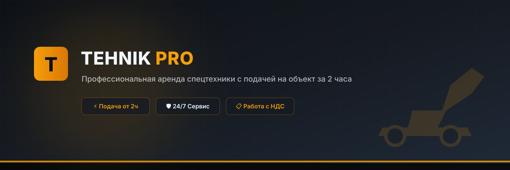

# -TEHNIK-PRO
Modern heavy equipment rental website featuring 2-hour delivery, an interactive machinery catalog, a dynamic shift and delivery calculator, full mobile responsiveness, and an instant order form. Operator and fuel included.

  # TEHNIK PRO — Heavy Equipment Rental
  
  
<b>Современный лендинг и интерактивный демонстрационный проект для компании по аренде спецтехники.</b>

  

  

    
    
    
    
  

---

## 🚀 О проекте
**TEHNIK PRO** — это продающий веб-сайт для бизнеса по аренде тяжёлой строительной и специальной техники (экскаваторы, автокраны, манипуляторы, погрузчики). Проект разработан с акцентом на высокую конверсию, строгий индустриальный дизайн и богатый функционал «под ключ».

## ✨ Ключевые особенности
* **Интерактивный каталог:** фильтрация техники по категориям с плавной анимацией карточек.
* **Калькулятор смен:** динамический расчёт стоимости аренды с учётом количества смен, ночных работ и выезда за город.
* **Интеграция с формой:** возможность в один клик отправить выбранную машину или готовый расчёт из калькулятора в форму заявки.
* **Уникальный визуал:** кастомные векторные иллюстрации спецтехники и атмосферная индустриальная сцена на главном экране.
* **Адаптивность:** безупречная вёрстка для мобильных устройств, планшетов и десктопов.

## 🛠 Технологический стек
* **Frontend:** HTML5, Tailwind CSS (через CDN), Vanilla JavaScript.
* **UI/UX:** Тёмная премиальная тема, стекломорфизм (`backdrop-blur`), плавные переходы.
